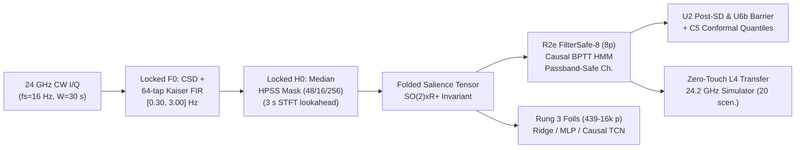

# Physics-Constrained Machine Learning for Contactless Neonatal Radar Respiratory Monitoring
### Parsimony, Causal Inductive Bias, and Safety-Aware Uncertainty Quantification

**Brandenburg University of Technology Cottbus-Senftenberg (BTU)**  
**Faculty 1 — M.Sc. Artificial Intelligence (Module 13600, 30 ECTS)**  
**Author:** Hosam Shibly | **Sealed Experimental Core:** `thesis/main` (`5e458c1`) | **Frozen Archive:** `af33a83e157f7d2e`

[](#start-here-10-minute-supervisor-review)
[](#start-here-10-minute-supervisor-review)
[](#start-here-10-minute-supervisor-review)
[](#manuscript-compilation)

This repository contains the complete, cryptographically verified codebase, claim-gated audit ledger, and LaTeX source for a Master's thesis investigating whether encoding physical radar symmetries ($SO(2)\times\mathbb{R}_{>0}$ I/Q invariance, frequency translation equivariance, and causal discrete Markov continuity) into an **8-parameter differentiable Hidden Markov Model (`FilterSafe-8`, `R2e`)** outperforms high-capacity unconstrained regressors (`439`–`15,817` parameters) across internal preterm NICU validation, pause-safe selective uncertainty, and zero-touch external hardware transfer.

---

## Start Here: 10-Minute Supervisor Review

Rather than reading `19.3k` lines of orchestration and clean-room audit boilerplate, start with the curated review layer:

1. **Verify integrity & run all automated tests (`~45 s`):**
   ```bash
   pip install -r requirements-thesis.txt
   python3 verify_submission.py
   ```
   Verifies `113/113` SHA-256 freeze-manifest hashes, checks the frozen Stage 4 model archive (`af33a83e...`), runs the `31/31` portable pytest tests on a fresh clone (auto-deselecting the `4` tests that require the unbundled `>4 GB` Zenodo/Figshare raw corpora; all `35/35` run automatically when the full raw corpora are present or via `--force-all-pytest`), and prints the Stage 2–4 tables straight from immutable JSON logs.
2. **Run or browse the clean executable code tour (`~5 s`):**
   - View rendered outputs & Okabe-Ito plots inline on GitHub: **[`notebooks/supervisor_code_tour.ipynb`](notebooks/supervisor_code_tour.ipynb)**
   - Or run standalone in terminal: `python3 examples/filtersafe_tour.py`
3. **Trace every thesis chapter & equation to exact symbols and line numbers:**
   - **[`REVIEWER_GUIDE.md`](REVIEWER_GUIDE.md)** maps Chapters 2–6 directly to the `7` core algorithm modules (`~4.5k` LOC total).

---

## Architecture & Verification Pipeline



---

## Headline Audited Results

### 1. Stage 2 NICU LOPO Complexity Ladder (`pool30_sync`: $K=11$ infants, $S=28$ sessions) & Stage 4 External Transfer

| Model | Params | Lookahead (`Blk/STFT`) | NICU `1 Hz` $\mathrm{RMSE}_{\mathrm{sess}}$ | NICU `Trig -10 s` $\mathrm{RMSE}_{\mathrm{sess}}$ ($p_{\mathrm{Holm}}$ vs `R0`) | External In-Band `>=28 bpm` (Slope) | External `20 bpm` Skirt |
| :--- | :---: | :---: | :---: | :---: | :---: | :---: |
| `R0` Locked `HPSS+NLS` | `0` | `0 / 3 s` | `7.817` | `8.727` (baseline) | `0.031` | `0.214` |
| `R1a` Online Fwd MMSE | `3` | `0 / 3 s` | `6.990` | `8.197` (`0.1953`) | `0.025` | `0.156` |
| `R1f` Offline FB MMSE | `3` | `inf / 3 s` | `6.395` | `7.597` (`0.0117`) | `0.008` | `0.044` |
| **`R2e` `FilterSafe-8`** | **`8`** | **`0 / 3 s`** | **`6.849`** (`p_Holm=0.0117`) | **`8.063`** (**`0.0215`**, `10/11` inf.) | **`0.0197`** (**`0.9994`**) | **`0.0949`** |
| `R3c` Spectral Ridge | `439` | `0 / 3 s` | `5.798` | `8.102` (`1.0000`) | `3.6353` (`0.7090`) | `11.7783` |
| `R3b` Spectral MLP | `14,593` | `0 / 3 s` | `6.584` | `8.515` (`1.0000`) | `3.5022` (`0.9293`) | `32.7040` |
| `R3a` Causal TCN | `15,817` | `0 / 3 s` | `6.075` | `8.498` (`1.0000`) | `3.1782` (`0.8623`) | `23.4714` |

- **Parsimony saturation:** `R2e` vs. `R1a` is Holm-non-significant ($p_{\mathrm{pat,Holm}} = 0.6641$ on `1 Hz`, $1.0000$ on `Trig -10 s`), showing benefit saturates around `3–8` physical parameters.
- **Protocol disclosure:** `R3a`/`R3b` use one held-out validation infant for early stopping (`10` fit / `1` val in LOPO; Patient 12 held out for Stage 4 refit), whereas `R3c` and `R2*` train on all available training infants (`11` in Stage 4) and `R3c` still collapses externally.

### 2. Stage 3 Uncertainty Quantification, Quiet-Pause Safety & Finite-$K$ Conformal Bounds (`R2e`)

- **Selective risk (`U2_Posterior_SD`, strictly zero-parameter & threshold-free):** Improves E-AURC across `10/11` infants on `1 Hz` (`-0.2454 bpm`, raw $p_{\mathrm{pat}} = 0.0098$, Holm $0.0781$) and `9/11` on `Trig -10 s` (`-0.2929 bpm`, raw $p_{\mathrm{pat}} = 0.0244$, Holm $0.1953$) while keeping quiet `>5 s` pause rejection near unity (`1.02x`).
- **Pause-safety vs. OOD trade-off (`U6b`):** Memoryless spectral entropies (`U3`/`U4`: `1.39x–1.42x`) and the `5`-parameter regularized linear composite (`U6c`: `1.23x`, `1 Hz` CI `[-0.5926, +0.0266]`) violate the `<= 1.15x` pause-safety cap; `U6b` (zero-fitted-weight heuristic geometric barrier with $\tau_{\mathrm{ood}}=0.90$, 3-hop history) achieves `1.1275x` pooled / `1.1209x` session pause safety, `0.9986` WGN AUROC (`0.0036` FPR@95%TPR), and `0.9998` Stage 4 stopband AUROC.
- **Finite-$K$ conformal limit:** At $K_{\mathrm{cal}}=10$ exchangeable calibration infants, $\alpha_{\min}=1/11\approx 0.0909$, rendering **95% patient-exchangeable split-conformal intervals vacuous (`width = inf`; $K_{\mathrm{cal}}\ge 19$ required)**; at `80%`, hierarchical adaptive calibration (`C5`) attains `0.8636` mean infant coverage (`2/11` undercovered) with **`24.02 bpm` mean full width** on NICU recordings (`18.02 bpm` / `100%` coverage in-band on external `gleichauf2024`).

### 3. Epistemic Claim-Gate Status

| Level | Status | Scope |
| :---: | :---: | :--- |
| **`L0–L1`** | Authorized | Cryptographic `v1` parity (`0.0 bpm` on `33/33` caches) & `HPSS+NLS` vs. `NMF+NLS` TOST equivalence ($\pm 0.50\text{ bpm}$). |
| **`L2`** | **BLOCKED** | Exact reproduction of Beltrao et al. (2022) [DOI `10.1038/s41598-022-08836-3`] `N=18` cohort/denominator/proprietary rules. |
| **`L3 / L3+`** | Authorized | Strict `11`-infant LOPO evaluation, branch-neutral sync, dual references (`1 Hz` & `Trig -10 s`), Holm & symmetry audits. |
| **`L4`** | Authorized | Zero-touch physical hardware transfer after Gate `G4` freeze onto external `24.2 GHz` phantom (`gleichauf2024`, 20 scenarios). |
| **`L5`** | **BLOCKED** | Prospective clinical utility, autonomous apnea alarming, or wired-monitor replacement (`24.02 bpm` 80% clinical uncertainty gap). |

---

## Repository Map

```text
medical_radar/
├── README.md                          # Executive overview & reproduction quickstart
├── REVIEWER_GUIDE.md                  # Chapter/Equation -> Exact File::Symbol(Lines) examiner map
├── verify_submission.py               # 1-command SHA-256 + pytest (35/35) + metrics table verifier
├── requirements-thesis.txt            # Python 3.10+ dependencies for thesis/ and tests/
├── examples/filtersafe_tour.py        # Self-contained ~220-LOC runnable walkthrough
├── notebooks/supervisor_code_tour.ipynb # Pre-executed GitHub-renderable tour with inline plots
├── manuscript/                        # 109-page twoside LaTeX monograph (scrreprt, Tectonic)
├── thesis/                            # Frozen Stages 0-4 Python modules (at commit 5e458c1)
│   └── outputs/stage3_uncertainty/frozen_stage4_models.npz  # Tracked frozen Gate G4 weights (259 KB)
├── tests/                             # 35/35 automated causality, invariance, BPTT & contract tests
├── paper_workspace/                   # Locked Python 3.9.6 v1 baseline engine & 33 SHA-256 caches
├── paper_orchestra_bundle/            # Raw audited JSON metrics, locked notation_glossary.tex, BibTeX & figures
├── audit/                             # SHA-256 manifests (113/113) & clean-room verification logs
├── beltrao_data/                      # Tracked test fixtures (Sessions 7.3 & 2.3) + MATLAB helpers
├── external_data/gleichauf2024/       # Figshare 24.2 GHz phantom manifests (49/49 extracted SHA-256s)
└── docs/baseline_archive/             # Archived student baseline project logs (AUDIT_PLAN, Engineering Log)
```

---

## Manuscript Compilation & External Datasets

- **Compile PDF (`109` pages, `0` errors, `0` warnings, `0` Overfull `>5 pt`):**
  ```bash
  tectonic -X compile -C --keep-logs --outdir manuscript/build manuscript/main_thesis.tex
  ```
- **Legacy `v1` Baseline Verification (`Python 3.9.6`):**
  ```bash
  /usr/bin/python3 -m paper_workspace.src.test_pipeline   # 19/19 checks require full beltrao_data/ (first 12 checks run on tracked Session 7.3)
  ```
- **Re-running Full 28-Session / 20-Scenario `thesis/exp*.py` Sweeps (Optional):**
  - Clinical NICU corpus (`33` sessions, `beltrao_data/`): referenced in Beltrao et al. (*Scientific Reports* 12, 5150, 2022, DOI [`10.1038/s41598-022-08836-3`](https://doi.org/10.1038/s41598-022-08836-3)), verified locally against `audit/postfix_manifest.sha256` (`154/154` baseline subset) and `paper_workspace/metadata/cohort_ledger.csv`.
  - External 24.2 GHz neonatal thorax simulator (`3.58 GiB` extracted subset, `49` files, 20 scenarios): Gleichauf et al. (*Scientific Data* 11, 110, 2024, DOI [`10.1038/s41597-024-02946-5`](https://doi.org/10.1038/s41597-024-02946-5); Figshare collection [`10.6084/m9.figshare.c.6809370.v1`](https://doi.org/10.6084/m9.figshare.c.6809370.v1)), verified locally against [`external_data/gleichauf2024/extracted_manifest.json`](external_data/gleichauf2024/extracted_manifest.json).
  - Precomputed master metric JSONs are tracked in git under [`paper_orchestra_bundle/raw_materials/`](paper_orchestra_bundle/raw_materials/), and `beltrao_data/` test fixtures (Sessions `7.3` & `2.3`) + [`frozen_stage4_models.npz`](thesis/outputs/stage3_uncertainty/frozen_stage4_models.npz) are bundled so `verify_submission.py` (`113/113` freeze manifest + `31/31` portable pytest tests; `35/35` with full raw corpora) and `examples/filtersafe_tour.py` pass cleanly out-of-the-box on any fresh clone.
